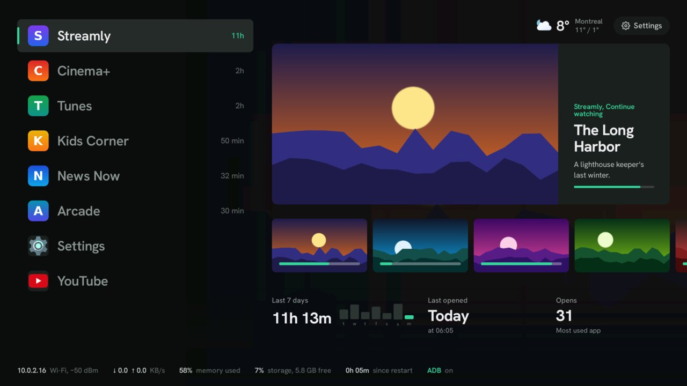
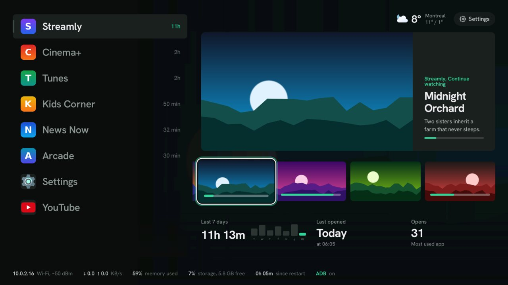
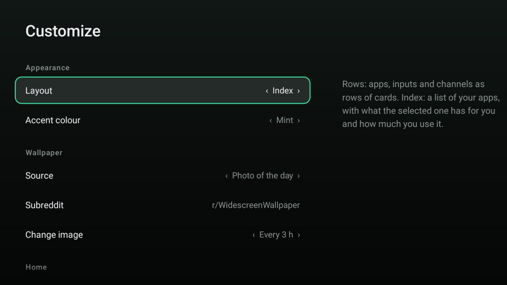
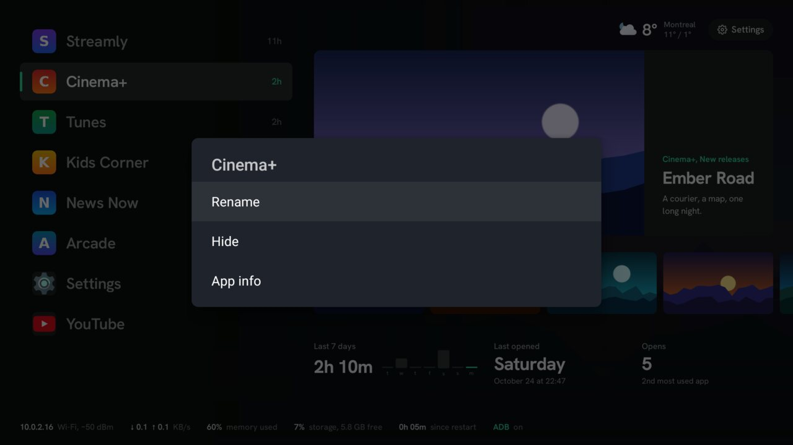

## What it looks like

  <figure>
    
    <figcaption>Home: your apps by screen time, and what the selected one offers.</figcaption>
  </figure>
  <figure>
    
    <figcaption>Preview channels from the apps you use.</figcaption>
  </figure>
  <figure>
    
    <figcaption>Customize: every option, from the remote.</figcaption>
  </figure>
  <figure>
    
    <figcaption>Long-press an app to rename or hide it.</figcaption>
  </figure>

## Features

- Your apps ordered by screen time, beside what the selected one offers: its preview channel,
  the program's title and synopsis, and your week with it.
- An Inputs list with brand logos (PlayStation, Xbox, Nintendo Switch, Apple TV…).
- Wallpaper: Bing photo of the day, the best images of a subreddit, a gradient, or your own.
- Weather (Open-Meteo, located automatically or by city), now playing.
- Ambient mode after a few idle minutes: full-screen wallpaper, large clock, weather.
- Long-press an app to rename or hide it.
- Updates itself: an Update button appears when a new release is out.

The interface is in English, or French on a TV set to French. Start with [Setup](./setup).

